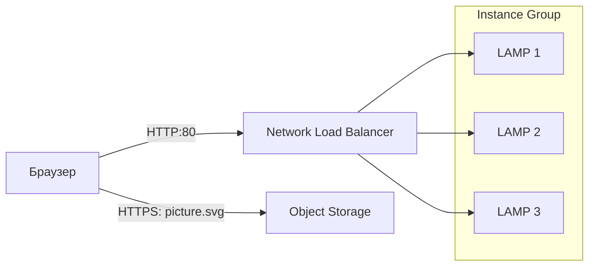
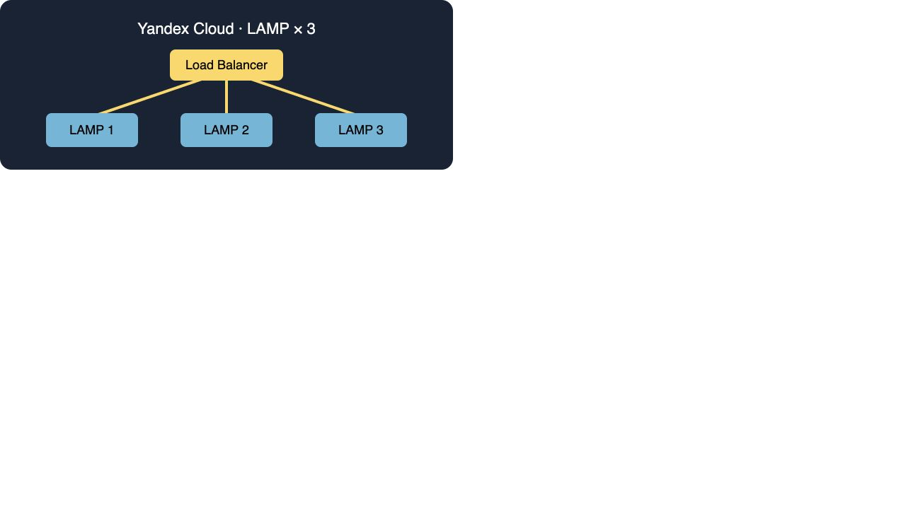
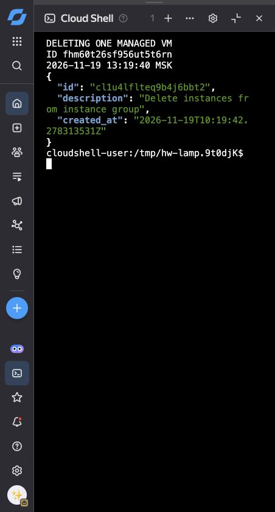

# Вычислительные мощности и балансировка нагрузки

Практическая работа выполнена в Yandex Cloud. Конфигурация находится в [main.tf](main.tf), страница ВМ задаётся через [cloud-init](cloud-init.yaml.tftpl).

| Компонент | Параметры |
|---|---|
| Каталог | `cloud-maver-a / default` |
| Сеть и подсеть | VPC `default`, подсеть `hw-lamp-public`, `10.76.10.0/24`, `ru-central1-a` |
| Instance Group | `hw-lamp-group`, фиксированный размер 3, образ LAMP `fd827b91d99psvq5fjit` |
| Каждая ВМ | 2 vCPU с гарантированной долей 20%, 2 ГБ RAM, HDD 3 ГБ, публичный IPv4 |
| NLB | `hw-lamp-nlb`, TCP/80 → TCP/80, HTTP-проверка `/healthz` |
| Object Storage | `marat-lamp-20261118-2026-a5jtk7`, объект `picture.svg` с `public-read` |

Сайт через NLB — [37.230.168.186](http://37.230.168.186/). Картинка доступна напрямую из [Object Storage](https://storage.yandexcloud.net/marat-lamp-20261118-2026-a5jtk7/picture.svg).



На странице выводится hostname ответившей ВМ. Instance Group проверяет `/healthz` для восстановления нездоровых экземпляров. NLB проверяет тот же путь, чтобы направлять новые соединения к здоровым целям. Браузер загружает картинку по её HTTPS-адресу.

## Повторный запуск

Нужны Terraform 1.5+, настроенный `yc` и права на создание ресурсов и назначение ролей сервисным аккаунтам. Проверено с Terraform 1.5.7 и провайдером `yandex-cloud/yandex` 0.250.0.

```bash
cp terraform.tfvars.example terraform.tfvars
# Укажите cloud_id, folder_id и уникальное имя бакета.
# При исчерпанной квоте на VPC укажите existing_network_id.
export YC_TOKEN="$(yc iam create-token)"
terraform init
terraform validate
terraform plan -out=homework.tfplan
terraform apply homework.tfplan
```

Квота `vpc.networks.count` потребовала использовать существующую VPC `default`. Учебная подсеть и правила доступа созданы отдельно. Для публичных IPv4 сервисному аккаунту `hw-lamp-group` понадобилась `vpc.publicAdmin` в дополнение к `compute.editor` и `load-balancer.editor`. Из-за квоты HDD 20 ГБ в `ru-central1-a` размер загрузочного диска уменьшен до 3 ГБ, минимального размера для выбранного образа.

## Проверка

```bash
site=$(terraform output -raw website_url)
picture=$(terraform output -raw picture_url)
ig=$(terraform output -raw instance_group_id)
lb=$(terraform output -raw load_balancer_id)
tg=$(terraform output -raw target_group_id)

curl -fsSI "$picture"
curl -fsS "$site/healthz"
curl -fsS "$site/"
yc compute instance-group list-instances "$ig"
yc load-balancer network-load-balancer target-states "$lb" --target-group-id "$tg"
```

Для проверки восстановления после удаления запустите серию HTTP-запросов к адресу NLB. Выберите ID одной ВМ из вывода `list-instances` для `hw-lamp-group` и удалите её с созданием замены.

```bash
yc compute instance-group delete-instances "$ig" \
  --instance-ids "$vm_id" --create-another --async
```

Повторно проверьте состав группы и `target-states`. У восстановленного экземпляра должен быть новый ID. Время между запросами влияет на то, какие перебои можно обнаружить.

## Результаты

- 19 ноября 2026 года Terraform применил конфигурацию. Три экземпляра перешли в `RUNNING_ACTUAL`, три цели NLB — в `HEALTHY`. [До удаления](screenshots/02-before-deletion.jpg).
- Публичный объект вернул HTTP 200 и `content-type: image/svg+xml`. [Картинка в браузере](screenshots/01-public-picture.jpg).
- До теста удаления `/healthz` через публичный NLB ответил `ok`, главная страница вернула hostname `hw-lamp-1` и ссылку на картинку из бакета. Открытие HTTP-адреса в браузере Codex было отклонено на этапе разрешения доступа, поэтому проверка страницы подтверждена выводом `curl` в Cloud Shell.
- В 13:19:42 МСК началось удаление ВМ `hw-lamp-1` (`fhm60t26sf956ut5t6rn`). Балансировщик снял её с обслуживания, две другие цели остались `HEALTHY`. [Операция удаления](screenshots/03-delete-operation.jpg) · [Во время замены](screenshots/04-during-deletion.jpg).
- К 13:25:03 МСК группа восстановила три ВМ в `RUNNING_ACTUAL`. Замена `hw-lamp-1` получила ID `fhmhess3i4ih4ahefa0f` и адрес `10.76.10.3`. Все три цели NLB вернулись в `HEALTHY`. [После восстановления](screenshots/05-recovered.jpg).

| Здоровых целей / зарегистрировано | Число замеров |
|---|---:|
| 2 / 2 | 52 |
| 2 / 3 | 5 |
| 3 / 3 | 20 |

За 77 замеров API балансировщика фиксировал минимум две здоровые цели. Это проверка состояния NLB. Непрерывность HTTP-ответов во время удаления отдельно не измерялась.



| До удаления | Команда удаления | Во время замены | После восстановления |
|---|---|---|---|
|  |  |  |  |

## Terraform state

State развёрнутого стенда сохранён в `~/hw-lamp-20261119/terraform.tfstate` в Cloud Shell. Для команд из временной рабочей папки передавайте `-state="$HOME/hw-lamp-20261119/terraform.tfstate"`. State содержит секрет S3-ключа и исключён из репозитория вместе с plan-файлами.

Для удаления стенда используйте `terraform plan -destroy` и `terraform apply` с сохранённым state. Пока ресурсы существуют, действует тарификация Yandex Cloud.

[Документация Instance Group с NLB](https://yandex.cloud/en/docs/compute/operations/instance-groups/create-with-balancer) · [Команда удаления одной ВМ с заменой](https://yandex.cloud/en/docs/compute/cli-ref/v0/instance-group/delete-instances)
