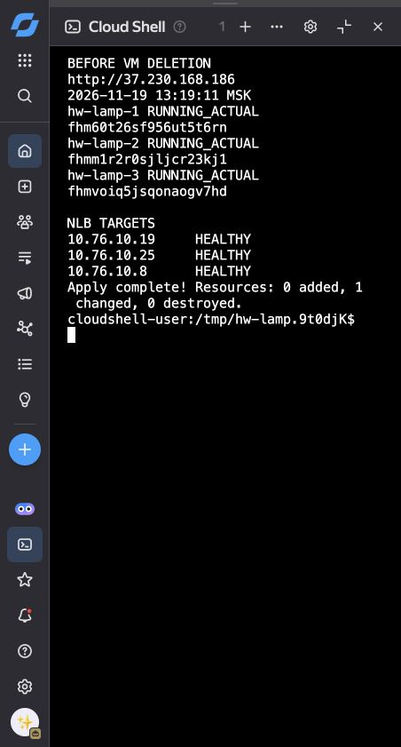
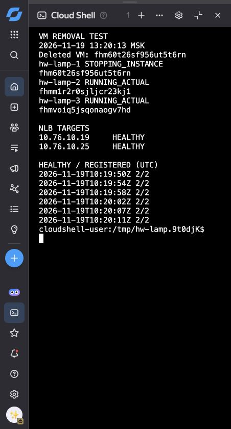
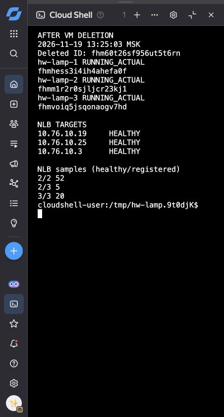

# 15.2. Вычислительные мощности и балансировка нагрузки

[Конфигурация Terraform](main.tf)

## 1. Object Storage

Создал бакет `marat-lamp-20261118-2026-a5jtk7` и загрузил [picture.svg](picture.svg). Файл [доступен из интернета](https://storage.yandexcloud.net/marat-lamp-20261118-2026-a5jtk7/picture.svg) без авторизации.

## 2. Группа ВМ с LAMP

Создал группу из трёх ВМ в публичной подсети `hw-lamp-public` с образом `fd827b91d99psvq5fjit`. Стартовая страница со ссылкой на картинку задаётся через [user-data](cloud-init.yaml.tftpl). Проверка ВМ — HTTP `/healthz`.

## 3. Сетевой балансировщик

Подключил группу к [Network Load Balancer](http://37.230.168.186/) на порту 80. Удалил одну ВМ: две цели остались здоровыми, затем группа создала замену.

| Удаление ВМ | Во время замены | После восстановления |
|---|---|---|
|  |  |  |

## 4. Application Load Balancer (дополнительно)

Не выполнялся.
