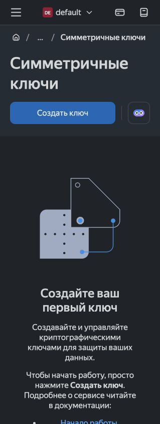
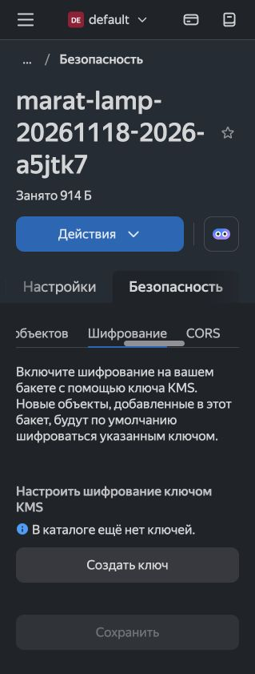
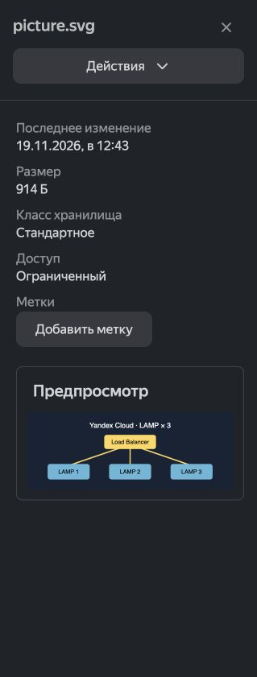

# 15.3. Шифрование Object Storage ключом KMS

[Условия задания](../15.3.md) · [Ключ KMS и права доступа](kms.tf) · [Патч для бакета 15.2](bucket-encryption.patch)

## 1. Симметричный ключ KMS

В Terraform описал ключ AES-256 с годовой ротацией и защитой от удаления. Для сервисного аккаунта бакета задал роль шифрования и расшифрования на уровне ключа. Идентификатор ключа предусмотрен в выходном параметре для 15.4.

**Результат проверки.** Конфигурация прошла `terraform validate`. В выбранном каталоге Yandex Cloud список ключей пуст.

## 2. Шифрование существующего бакета

Подготовил патч к конфигурации 15.2. Он добавляет `aws:kms` в настройки существующего бакета и переводит `picture.svg` в приватный доступ. После такого изменения анонимная загрузка картинки со страницы LAMP по прежнему URL станет недоступна.

**Результат проверки.** Патч применился к исходному файлу 15.2 при локальной проверке. В облачной консоли бакет найден, шифрование пользовательским KMS-ключом ещё не настроено.

## 3. Проверка объекта

В бакете найден `picture.svg` размером 914 Б. Этот объект загружен до включения KMS. Для подтверждения шифрования нужна повторная запись объекта и проверка `ServerSideEncryption` и `SSEKMSKeyId` через `HeadObject`. Результата этого запроса пока нет.

