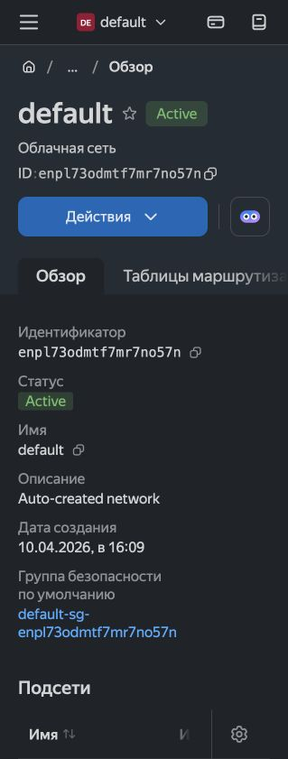
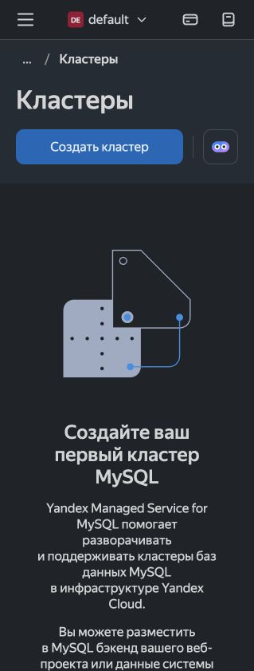
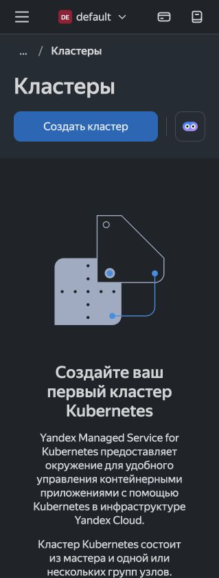

# 15.4. Managed MySQL и Kubernetes в Yandex Cloud

[Условия задания](../15.4.md) · [VPC и переменные](main.tf) · [MySQL](mysql.tf) · [Kubernetes и IAM](kubernetes.tf) · [Пример параметров](terraform.tfvars.example)

## 1. VPC и подсети

В Terraform заложил подключение двух существующих подсетей зоны `ru-central1-a` и добавление трёх подсетей в той же VPC.

| Зона | Kubernetes | MySQL |
|---|---|---|
| `ru-central1-a` | Существующая public | Существующая private |
| `ru-central1-b` | Новая public `192.168.11.0/24` | Новая private `192.168.21.0/24` |
| `ru-central1-d` | Новая public `192.168.12.0/24` | — |

**Результат проверки.** В открытом каталоге нашёл сеть `default` с подсетями в зонах B и E и подсетью `hw-lamp-public` в зоне A. Отдельной исходной private-подсети в зоне A в этой сети нет. Таблица выше описывает конфигурацию задания.

## 2. Managed MySQL

| Пункт | Что задано в Terraform |
|---|---|
| Отказоустойчивость | Два хоста в зонах A и B, отдельные приватные подсети, публичные IP отключены. Репликацией и выбором мастера управляет сервис. |
| Окружение и диск | `PRESTABLE`, MySQL 8.0, SSD 20 ГБ на хост. |
| Ресурсы | Класс `s2.micro` с гарантией 100% CPU. Создание новых кластеров на классе Broadwell с гарантией 50% CPU недоступно. |
| Обслуживание и резервное копирование | `ANYTIME`, начало бэкапа в 23:59 UTC. |
| Защита и доступ | Защита от удаления включена. Описаны база `netology_db` и пользователь `netology`. |

**Результат проверки.** Terraform-конфигурация прошла валидацию. В выбранном облачном каталоге список кластеров MySQL пуст. Состояние хостов, репликации, БД и пользователя в облаке пока не подтверждено. [Классы хостов MySQL](https://yandex.cloud/en/docs/managed-mysql/concepts/instance-types)

## 3. Managed Kubernetes

| Пункт | Что задано в Terraform |
|---|---|
| Региональный мастер | Три публичные подсети в зонах A, B и D. Доступ к внешнему API ограничен IP оператора. |
| Сервисный аккаунт | Отдельный аккаунт с ролями для управления кластером и сетью, скачивания образов и использования ключа. |
| Шифрование | Для Kubernetes Secrets указан ключ KMS из [15.3](../15.3/README.md). |
| Рабочие узлы | Три зональные группы. В каждой от 1 до 2 узлов, суммарно от 3 до 6. Одна группа с автомасштабированием ограничена одной зоной. |
| Подключение | `kubectl cluster-info` и `kubectl get nodes -L topology.kubernetes.io/zone` остаются облачными проверками. |

**Результат проверки.** Terraform-конфигурация прошла валидацию. В выбранном облачном каталоге список кластеров Kubernetes пуст. Проверка подключения через `kubectl` и статуса узлов пока не выполнена. [Группы узлов Yandex Cloud](https://yandex.cloud/en/docs/managed-kubernetes/operations/node-group/node-group-create)

